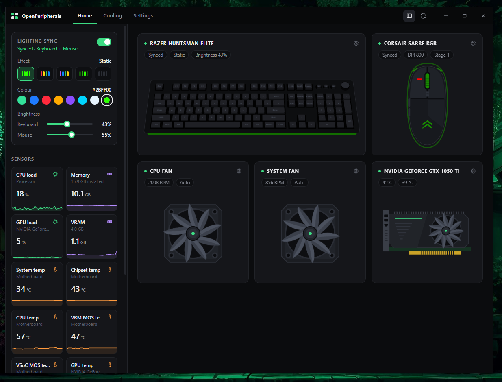

# OpenPeripherals

> **Beta:** OpenPeripherals is in active development. Expect rough edges, and please report devices that misbehave.

Lightweight RGB, DPI and fan control for your keyboard, mouse and PC, with no vendor software. One small app replaces Razer Synapse, Corsair iCUE, Logitech G HUB and friends for everyday settings.

## Features

- **Lighting:** hardware effects (static, spectrum, wave, breathing, reactive, starlight and more), colours, speed and brightness, previewed live on a 3D model of your board.
- **Lighting sync:** one effect and colour across keyboard and mouse, animated from a single clock.
- **Mouse settings:** DPI and DPI stages, polling rate, lift-off distance, debounce, sleep timer, sensor options and battery level.
- **Fan control:** motherboard and NVIDIA GPU fans on Auto, a fixed speed or a temperature curve, with safety limits.
- **Disable keys:** turn off any key, media keys or the Huntsman Elite's dial (replaces Synapse's "Disable").
- **Live sensors:** CPU, GPU, memory, VRAM and temperatures with 60-second trends.
- **Stays out of the way:** runs from the tray, starts with Windows, and writes settings to the devices themselves so they stick after the app closes.

## Supported devices

| Brand               | Devices                                                                                           | Lighting                                                                                                                  | Other settings                                                                                                    |
| ------------------- | ------------------------------------------------------------------------------------------------- | ------------------------------------------------------------------------------------------------------------------------- | ----------------------------------------------------------------------------------------------------------------- |
| **Razer** keyboards | 81 models: BlackWidow, Huntsman, DeathStalker, Ornata, Anansi, Tartarus, Blade and Book laptops   | Static, spectrum, wave, breathing (single / dual / random), reactive, starlight, colour wheel (BlackWidow V4), brightness | Game mode, macro key lights, battery (wireless)                                                                   |
| **Razer** mice      | 68 models: DeathAdder, Viper, Basilisk, Naga, Cobra, Mamba, Lancehead, Orochi, Atheris, Pro Click | Static, spectrum, breathing, reactive                                                                                     | DPI, polling rate up to 8000 Hz, lift-off distance, sleep timer, battery                                          |
| **Corsair**         | SABRE RGB, SABRE RGB Optical, SABRE RGB Laser                                                     | Per-zone colours (underglow, logo, wheel), brightness                                                                     | 6 DPI stages with indicator colours                                                                               |
| **Logitech**        | G213, G512, G610, G810, G910, G910 Orion Spark, G Pro, G813, G815, G915, G915 TKL                 | Static, colour cycle, breathing; wave (G213, G915); ripple (G915); speed                                                  |                                                                                                                   |
| **Redragon**        | K550, K552, K556, K582, K587, K589, K512                                                          | Static, spectrum, wave, breathing, reactive, starlight; speed, direction, brightness                                      |                                                                                                                   |
| **Pulsar**          | Pulsar mice and the Pulsar 4K receiver                                                            |                                                                                                                           | DPI, polling rate, lift-off distance, debounce, Motion Sync, angle snapping, ripple control, sleep timer, battery |
| **Fans**            | ITE Super I/O motherboard headers, NVIDIA GPU fans                                                |                                                                                                                           | Auto, fixed % or temperature curve                                                                                |

<b>All Razer keyboards</b>

BlackWidow Chroma, BlackWidow Chroma TE, BlackWidow Chroma (Overwatch), BlackWidow Chroma V2, BlackWidow Ultimate 2016, BlackWidow X Chroma, BlackWidow X Chroma TE, BlackWidow X Ultimate, BlackWidow Essential, BlackWidow Elite, BlackWidow V3, BlackWidow V3 Tenkeyless, BlackWidow V3 Pro, BlackWidow V4 X, BlackWidow V4 Pro, BlackWidow V4 75%, Huntsman Elite, Huntsman Tournament Edition, Huntsman Mini, Huntsman V2, Huntsman V2 Tenkeyless, Huntsman V3 Pro, Huntsman V3 Pro TKL, Huntsman V3 Pro Mini, DeathStalker Chroma, DeathStalker V2, DeathStalker V2 Pro, DeathStalker V2 Pro TKL, Ornata V2, Anansi, Tartarus Chroma, Book 13 (2020).

Blade laptops: Blade Stealth (2016 to 2020), Blade QHD, Blade (Late 2016), Blade Pro (2016, 2017, Late 2019), Blade Pro FullHD (2017), Blade Pro 17 (2019, 2020), Blade 15 (2018 to 2023, Base, Advanced, Mercury and Studio editions), Blade Advanced (Late 2019), Blade 17 / 17 Pro (2021, 2022), Blade 14 (2021 to 2025), Blade 16 (2023, 2025), Blade 18 (2023 to 2025).

The exact list, with product IDs, is in [`internal/razer/keyboards.go`](internal/razer/keyboards.go).

<b>All Razer mice</b>

Abyssus 1800, Atheris, Basilisk, Basilisk Essential, Basilisk Ultimate, Basilisk V2, Basilisk V3, Basilisk V3 35K, Basilisk V3 Pro, Basilisk V3 Pro 35K, Basilisk V3 X HyperSpeed, Basilisk X HyperSpeed, Cobra Pro, DeathAdder 2013, DeathAdder Chroma, DeathAdder Elite, DeathAdder Essential (incl. White Edition and 2021), DeathAdder V2, DeathAdder V2 Lite, DeathAdder V2 Mini, DeathAdder V2 Pro, DeathAdder V2 X HyperSpeed, DeathAdder V3, DeathAdder V3 Pro, DeathAdder V3 HyperSpeed, Lancehead Tournament Edition, Lancehead Wireless, Mamba Elite, Mamba Tournament Edition, Mamba Wireless, Naga, Naga 2012, Naga 2014, Naga Chroma, Naga Pro, Naga Trinity, Naga V2 HyperSpeed, Naga V2 Pro, Naga X, Orochi V2, Pro Click, Pro Click Mini, Taipan, Viper 8KHz, Viper Mini Signature Edition, Viper Ultimate, Viper V2 Pro, Viper V3 HyperSpeed, Viper V3 Pro.

Wireless models work over the receiver and on the cable. The exact list is in [`internal/razer/mice.go`](internal/razer/mice.go).

One keyboard and one mouse are controlled at a time. Devices are detected automatically within a few seconds of being plugged in.

## Platforms

| Platform | Status |
| --- | --- |
| Windows 10 / 11 | ✅ Supported |
| Linux | 🚧 Coming soon |

## Download

Get the latest build from the [Releases](../../releases) page: `openperipherals-amd64-installer.exe` installs the app (and WebView2 if needed), and `openperipherals.exe` runs without installing. Every push is also built by GitHub Actions; the files are attached to each run under **Actions → Build**.

## Getting started

1. Quit Razer Synapse, Corsair iCUE, Logitech G HUB and any other RGB software. They keep sending lighting to the devices and will overwrite what OpenPeripherals sets.
2. Run `openperipherals.exe`. Closing the window keeps it running in the tray; **Settings → Start with Windows** launches it there at login.
3. For motherboard fans, run it as administrator. They are controlled through the [PawnIO](https://pawnio.eu) driver.

### Good to know

- Razer, Corsair and Pulsar settings are saved on the device. Logitech and Redragon keyboards can't report their lighting back, so the app re-applies it when they connect.
- Animated sync is streamed to Razer keyboards and the SABRE in step. Other keyboards and Razer mice run the matching built-in effect.
- Disabled keys use a keyboard hook, so they only apply while the app is running (including from the tray). Media keys and the dial are blocked only on the connected keyboard; other keys are blocked on every keyboard.
- Fan safety: motherboard fans never go below 20% under app control, every controlled fan goes to 100% if the CPU reaches 90 °C or a curve's sensor stops reporting, and quitting hands every fan back to Auto.

## How it works

Go + Wails v3, a pure-Go HID layer (no cgo) and a small Svelte UI. Each brand has its own driver:

| Package                              | Protocol                                                                        |
| ------------------------------------ | ------------------------------------------------------------------------------- |
| `internal/hid`                       | Windows HID through setupapi / hid.dll                                          |
| `internal/razer`                     | Razer 90-byte feature reports, keyboards (classic and extended matrix) and mice |
| `internal/corsair`                   | Corsair NXP mouse protocol                                                      |
| `internal/logitech`                  | Logitech G 20-byte lighting reports                                             |
| `internal/redragon`                  | Redragon EVision 64-byte reports                                                |
| `internal/pulsar`                    | Pulsar report 8 flash configuration                                             |
| `internal/superio`, `internal/nvgpu` | ITE Super I/O and NVIDIA fan control                                            |

## Credits

Device protocols were reverse-engineered by [OpenRazer](https://github.com/openrazer/openrazer), [OpenRGB](https://gitlab.com/CalcProgrammer1/OpenRGB), [ckb-next](https://github.com/ckb-next/ckb-next) and [LibreHardwareMonitor](https://github.com/LibreHardwareMonitor/LibreHardwareMonitor).
